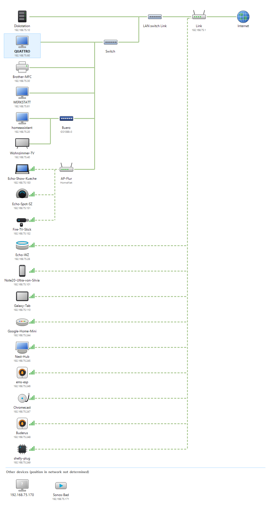

# Netzwerkübersicht (Network Overview)

[](https://github.com/Schimmelreiter/network-overview/actions/workflows/build.yml)

**English:** [README.md](README.md)

Ein Nachbau der **Netzwerkübersicht** aus Windows 7 für aktuelle Windows-Versionen. Das Programm
zeigt, wie dein Netz aufgebaut ist – Internet, Router, Switches, Zugangspunkte und Geräte – und
ermittelt die Switch-Struktur mit demselben Verfahren wie Windows 7: dem Protokoll
**Link Layer Topology Discovery (LLTD)**.

<picture>
  <source media="(prefers-color-scheme: dark)" srcset="docs/example-dark.png">
  
</picture>

## Funktionen

- **LLTD-Erkennung und Topologietests**: findet LLTD-Responder und erkennt Switches – auch
  unverwaltete – an der Art, wie sie MAC-Adressen lernen. Geräte ohne LLTD (Router, Drucker,
  Handys …) werden ebenfalls in die Struktur eingeordnet.
- **OpenWrt per SSH**: WLAN-Clients mit Signalstärke, DHCP-Namen und Bridge-Ports von
  OpenWrt-Routern und -Zugangspunkten.
- **Netgear-Switches per NSDP** (ProSAFE Plus / Easy Smart, z. B. GS105E/GS108E): Name, Modell,
  IP-Adresse und Link-Status der Ports; der per LLTD gefundene Switch wird entsprechend benannt.
- **mDNS / DNS-SD (Bonjour, Avahi, Zeroconf)**: Namen, Modelle und Dienste, z. B. Cast-Geräte,
  Drucker, AirPlay, Fire TV, ESPHome, HomeKit.
- **SSDP / UPnP**: Namen und Modelle aus UPnP-Gerätebeschreibungen (Fernseher, Receiver, Router,
  neuere Netgear-Switches).
- **Gerätetypen mit eigenen Symbolen**: Echo Dot, Echo Spot, Echo Show, Fire TV, Google-Lautsprecher
  und -Displays, Chromecast, Smartphones, Tablets, Drucker, Fernseher, NAS, Receiver (Set-Top-Boxen wie Vu+, GigaBlue, Dreambox), Heizungsregler, Klimageräte, IP-Kameras,
  Lampen, IoT-Geräte.
- **Gerätebestimmung ohne Namen**: über das, was Geräte ankündigen (mDNS, SSDP/UPnP) und
  beantworten (eine kurze Liste aussagekräftiger TCP-Ports mit Banner, Webserver, Anmelde-Realm und
  TLS-Zertifikat, ONVIF/WS-Discovery, Magic Home, Tuya-Broadcasts), danach über den Hersteller der
  MAC-Adresse. Vom Benutzer vergebene Namen (DHCP/DNS) verfeinern nur noch zuletzt ein allgemeines
  Ergebnis und lassen sich abschalten. Die Details zeigen, woran ein Gerät erkannt wurde. Einmal
  erkannt, behält ein Gerät seinen Typ, auch wenn es später im Standby oder ausgeschaltet ist.
- **Letzte Karte beim Start**: Die vorige Karte erscheint sofort, während neu gescannt wird.
- Hell- und Dunkelmodus nach Windows-Einstellung, Sprachen Deutsch, Englisch, Spanisch und
  Französisch.
- Tooltips und Details, Kontextmenü (Weboberfläche, Freigaben, Videostreams von motionEye-Servern,
  Wake-on-LAN, Adressen kopieren), Zoom
  (Strg + Mausrad), Export als PNG, Protokoll des Scans.

## Voraussetzungen

- Windows 10 oder 11 (x64 oder ARM64).
- [**Npcap**](https://npcap.com/#download) für LLTD. Ohne Npcap zeigt das Programm weiterhin die
  Geräte aus ARP-Tabelle, OpenWrt, NSDP und mDNS, aber keine Struktur. Der „WinPcap
  API-compatible Mode“ ist nicht nötig. Wurde Npcap mit „Restrict Npcap driver's access to
  Administrators only“ installiert, das Programm als Administrator starten.
- **LLTD-Responder** auf möglichst vielen kabelgebundenen Geräten – je mehr, desto feiner das
  Ergebnis:
  - Windows: eingebaut. Das Netzwerkprofil muss *Privat* sein, und in den Adaptereigenschaften muss
    „Antwort für Verbindungsschicht-Topologieerkennung“ aktiviert sein.
  - Linux / OpenWrt: ein LLTD-Responder-Dienst (z. B. `lld2d` oder
    [LLTDResponder](https://github.com/d3vi1/LLTDResponder)).
- Optional: das Windows-Feature **OpenSSH-Client** und Schlüssel-Login auf den OpenWrt-Geräten.

## Herunterladen und starten

Die ausführbare Datei gibt es unter [Releases](https://github.com/Schimmelreiter/network-overview/releases):

| Datei | Beschreibung |
|-------|--------------|
| `NetworkOverview-<version>-win-x64.exe` | läuft ohne Installation (enthält .NET) |
| `NetworkOverview-<version>-win-x64-framework-dependent.exe` | klein, braucht die [.NET 10 Desktop Runtime](https://dotnet.microsoft.com/download/dotnet/10.0) |
| `…-win-arm64…` | dasselbe für Windows auf ARM |

Programm starten; der erste Scan beginnt automatisch. Ein vollständiger Scan mit Topologietests
dauert wenige Sekunden bis mehrere Minuten – grob *n²/2 + n·m* Tests zu je etwa einer Sekunde bei
*n* LLTD-Respondern und *m* weiteren Geräten. Der Fortschritt steht in der Statusleiste,
**Abbrechen** behält das Teilergebnis.

## Einstellungen

| Einstellung | Bedeutung |
|-------------|-----------|
| OpenWrt-Geräte | SSH-Ziele, durch Leerzeichen getrennt, z. B. `root@192.168.1.1 root@192.168.1.2`. Das Programm ruft `ssh -o BatchMode=yes` auf, der Schlüssel-Login muss also ohne Passwortabfrage funktionieren. |
| Topologie per LLTD ermitteln | Führt die Switch-Erkennung aus. Ohne sie nur die Erkennung der Geräte. |
| Geräte ohne LLTD ebenfalls einordnen | Ordnet Router, Drucker, Handys usw. in die Struktur ein (mehr Tests). |
| Netgear-Switches per NSDP abfragen | Broadcast-Abfrage auf UDP 63322/63324. |
| mDNS/Zeroconf-Dienste abfragen | Multicast-Abfrage auf UDP 5353. |
| UPnP-Geräte per SSDP abfragen | Multicast-Abfrage auf UDP 1900, danach die Gerätebeschreibungen per HTTP. |
| Geräte genauer bestimmen | Prüft je Gerät etwa 20 TCP-Ports (je Gerät nur eine Verbindung gleichzeitig) und hört auf ONVIF, Magic Home und Tuya; dauert wenige Sekunden und läuft parallel zu den Topologietests. |
| Gerätenamen verwenden | DHCP-/DNS-Namen dürfen ein allgemeines Ergebnis verfeinern (z. B. Echo Show statt Echo Dot, Smartphones). Kameras werden nie über den Namen erkannt. |
| Ganzes Subnetz anpingen | Füllt vor dem Scan die ARP-Tabelle (Subnetze bis /22). |
| Letzte Karte beim Start anzeigen | Zeigt das vorige Ergebnis sofort, während neu gescannt wird. |
| Höchstdauer | Zeitlimit für die Topologietests. |
| Sprache | Wie Windows, Deutsch, Englisch, Spanisch oder Französisch. |

Die Einstellungen liegen in `%APPDATA%\NetworkOverview\config.json`, die letzte Karte in
`lastmap.json` und die erkannten Gerätetypen je MAC-Adresse in `devices.json` im selben Ordner.
OpenWrt-Geräte, die nicht auf Ping antworten (ausgeschaltet), werden ohne Warnung übersprungen.

Probleme während eines Scans (keine gültige IPv4-Adresse, OpenWrt-Geräte nicht erreichbar,
LLTD-Responder, die keine Testrahmen empfangen, …) erscheinen in einem Hinweisbalken über der Karte;
Einzelheiten stehen im Protokoll.

### Netgear-Switches

ProSAFE-Plus- bzw. Smart-Managed-Plus-Switches antworten nur auf NSDP, wenn ihr Verwaltungsmodus das
Plus Utility erlaubt. Neuere Firmware (z. B. GS308E ab V1.00.05) stellt standardmäßig *Web browser
only* ein; unter *System → Management → Switch Management Mode* auf *Web browser and Plus Utility*
umstellen, dann liefert der Switch Name und Port-Status. Ohne NSDP werden Netgear-Switches trotzdem
über den Herstellerteil ihrer MAC-Adresse oder per UPnP erkannt und durch die LLTD-Tests eingeordnet.

### SSH-Schlüssel für OpenWrt

Den privaten Schlüssel nach `%USERPROFILE%\.ssh\` legen (`id_ed25519`, `id_ecdsa` oder `id_rsa`)
oder in `%USERPROFILE%\.ssh\config` angeben:

```
Host 192.168.1.1 192.168.1.2
    User root
    IdentityFile ~/.ssh/openwrt_ed25519
```

Auf OpenWrt (Dropbear) gehört der öffentliche Schlüssel nach `/etc/dropbear/authorized_keys`.
Testen mit `ssh -o BatchMode=yes root@192.168.1.1 echo ok`.

## So wird die Topologie ermittelt

Switches merken sich, an welchem Port eine MAC-Adresse zuletzt als Absender aufgetaucht ist. Das
Programm lässt LLTD-Responder Rahmen mit Testadressen aus einem für LLTD reservierten Bereich
senden und fragt danach alle, welche Testrahmen wo angekommen sind:

1. Eine Testadresse *X* wird an der Wurzel (diesem Computer) angelernt.
2. Responder *c* sendet einen Rahmen von *X* an Gerät *d* – jeder Switch auf dem Weg *c…d*
   verbindet *X* jetzt mit *c*.
3. Alle anderen Responder senden eine Probe an *X*. Sie kommt genau dann bei *c* an, wenn ihr Weg
   zur Wurzel den Weg *c…d* kreuzt.

Die Mengen der Geräte, deren Proben bei *c* ankommen, bilden eine Hierarchie – das ist der
Switch-Baum. Geräte ohne LLTD werden eingeordnet, indem sie als Ziel *d* dienen.
Kontrollproben, Flutungserkennung, Wiederholungen und Bestätigungsrunden machen das Ergebnis
robust gegen verlorene Rahmen.

Manche verwalteten Switches (z. B. Netgear Plus) fluten Rahmen an ihre eigene Verwaltungsadresse an
alle Ports. Ihre Position wird deshalb gesondert geprüft: Ein Responder sendet eine Probe an die
Verwaltungsadresse, und die Responder, die sie empfangen, hängen direkt an diesem Switch.
Responder, die keine Proben aufzeichnen können (z. B. hinter dem internen Switch eines Receivers),
dienen trotzdem als *c*: Ist der Mapper oder ein Beobachter als Wurzel per Kabel angeschlossen, ist
jede Probe, die nicht an der Wurzel ankommt, bei *c* gelandet. Solche abgeleiteten Runden werden mit
neuen Testadressen wiederholt und nur übernommen, wenn zwei Messungen übereinstimmen. OpenWrt-APs, die per WLAN mit einem anderen OpenWrt-AP
verbunden sind, erscheinen als WLAN-Repeater unter diesem AP.

Grenzen: Ein Switch, hinter dem nur ein einziges Gerät hängt, ist nicht erkennbar (auch nicht für
Windows 7), es sei denn, er hat eine eigene MAC-Adresse wie verwaltete Switches. Dasselbe gilt, wenn der
einzige Responder hinter einem Switch weder beobachten noch Lernrahmen senden kann. WLAN-Clients
können keine Rahmen mit fremder Absenderadresse senden; sie werden über OpenWrt-Daten oder ihre
BSSID zugeordnet.

## Bauen

```
dotnet build NetworkOverview.slnx -c Release
dotnet run --project tests/NetworkOverview.Tests -c Release
dotnet publish src/NetworkOverview/NetworkOverview.csproj -c Release -r win-x64 --self-contained false -o publish
```

Benötigt das .NET 10 SDK. Kernbibliothek und Tests (inklusive eines simulierten Ethernets mit
lernenden Switches und LLTD-Respondern) lassen sich auch unter Linux bauen und ausführen; die
Windows-Forms-Anwendung wird unter Windows gebaut.

Releases baut GitHub Actions – entweder ein Tag `v*` pushen oder den Workflow
*Actions → Release → Run workflow* mit einer Versionsnummer starten (das Tag wird dann automatisch angelegt):

```
git tag v1.0.0
git push origin v1.0.0
```

## Projektstruktur

| Pfad | Inhalt |
|------|--------|
| `src/NetworkOverview.Core` | LLTD-Mapper, NSDP, mDNS, OpenWrt, Geräteerkennung, Modell, Layout, Übersetzungen |
| `src/NetworkOverview` | Windows-Forms-Anwendung |
| `tests/NetworkOverview.Tests` | Tests inkl. Netz-Simulator (ohne externe Pakete) |
| `tools/update-oui.py` | erzeugt die Herstellertabelle neu |

## Lizenz

[GNU General Public License v3.0](LICENSE).

Die Herstellertabelle stammt aus dem IEEE-OUI-Verzeichnis in der Aufbereitung des
Wireshark-Projekts (`epan/manuf-data.c`, GPL-2.0-or-later). Die LLTD-Implementierung folgt
Microsofts öffentlicher Spezifikation [MS-LLTD]. Die Gerätesymbole sind generische Zeichnungen;
Produkt- und Markennamen dienen nur der Beschreibung der Kompatibilität.
