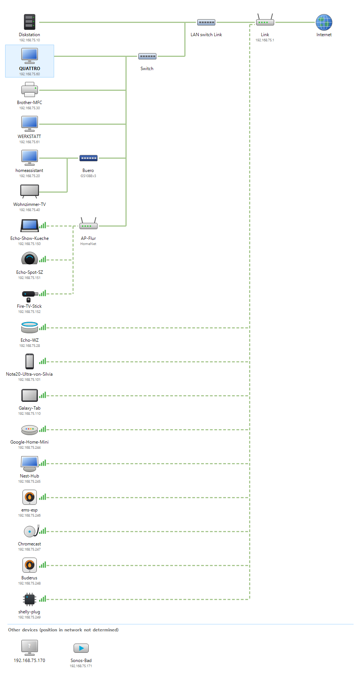

# Network Overview

[](https://github.com/Schimmelreiter/network-overview/actions/workflows/build.yml)

**Deutsch:** [README.de.md](README.de.md)

A re-creation of the Windows 7 **network map** for current Windows versions. It shows how your
network is built – Internet, router, switches, access points and devices – and determines the
switch structure with the same method Windows 7 used: the **Link Layer Topology Discovery (LLTD)**
protocol.

<picture>
  <source media="(prefers-color-scheme: dark)" srcset="docs/example-dark.png">
  
</picture>

## Features

- **LLTD discovery and topology tests**: finds LLTD responders and detects switches – also
  unmanaged ones – from how they learn MAC addresses. Devices without LLTD (router, printer,
  phones …) are placed into the structure as well.
- **OpenWrt via SSH**: Wi-Fi clients with signal strength, DHCP names and bridge ports of
  OpenWrt routers and access points.
- **Netgear switches via NSDP** (ProSAFE Plus / Easy Smart, e.g. GS105E/GS108E): name, model,
  IP address and port link state; the switch found by LLTD is labelled accordingly.
- **mDNS / DNS-SD (Bonjour, Avahi, Zeroconf)**: names, models and services, e.g. Cast devices,
  printers, AirPlay, Fire TV, ESPHome, HomeKit.
- **SSDP / UPnP**: names and models from UPnP device descriptions (TVs, receivers, routers, newer
  Netgear switches).
- **Device types with their own symbols**: Echo Dot, Echo Spot, Echo Show, Fire TV, Google speakers
  and displays, Chromecast, phones, tablets, printers, TVs, NAS, TV receivers (set-top boxes such as Vu+, GigaBlue, Dreambox), heating controllers, air conditioners, IoT devices. Detection uses mDNS,
  the vendor part of the MAC address and, if nothing else helps, the device name.
- Light and dark mode following Windows, languages German, English, Spanish and French.
- Tooltips and details, context menu (web interface, shares, copy addresses), zoom
  (Ctrl + mouse wheel), export as PNG, scan log.

## Requirements

- Windows 10 or 11 (x64 or ARM64).
- [**Npcap**](https://npcap.com/#download) for LLTD. Without Npcap the program still shows the
  devices from the ARP table, OpenWrt, NSDP and mDNS, but no structure. The option
  "WinPcap API-compatible mode" is not required. If you install Npcap with "Restrict Npcap driver's
  access to Administrators only", start the program as administrator.
- **LLTD responders** on as many wired devices as possible – the more, the finer the result:
  - Windows: built in. The network profile must be *Private* and "Link-Layer Topology Discovery
    Responder" must be enabled in the adapter properties.
  - Linux / OpenWrt: an LLTD responder daemon (e.g. `lld2d` or
    [LLTDResponder](https://github.com/d3vi1/LLTDResponder)).
- Optional: the Windows feature **OpenSSH Client** and key-based login to your OpenWrt devices.

## Download and start

Download the executable from the [releases](https://github.com/Schimmelreiter/network-overview/releases):

| File | Description |
|------|-------------|
| `NetworkOverview-<version>-win-x64.exe` | runs without installation (includes .NET) |
| `NetworkOverview-<version>-win-x64-framework-dependent.exe` | small, needs the [.NET 10 Desktop Runtime](https://dotnet.microsoft.com/download/dotnet/10.0) |
| `…-win-arm64…` | the same for Windows on ARM |

Start the program; the first scan begins automatically. A complete scan with topology tests takes
from a few seconds up to several minutes – roughly *n²/2 + n·m* tests of about one second each
for *n* LLTD responders and *m* other devices. The progress is shown in the status bar,
**Cancel** keeps the partial result.

## Settings

| Setting | Meaning |
|---------|---------|
| OpenWrt devices | SSH targets separated by spaces, e.g. `root@192.168.1.1 root@192.168.1.2`. The program calls `ssh -o BatchMode=yes`, so key login must work without a password prompt. |
| Determine topology via LLTD | Runs the switch detection. Without it only discovery is done. |
| Also place devices without LLTD | Places routers, printers, phones etc. into the structure (more tests). |
| Query Netgear switches via NSDP | Broadcast query on UDP 63322/63324. |
| Query mDNS/Zeroconf services | Multicast query on UDP 5353. |
| Query UPnP devices via SSDP | Multicast query on UDP 1900, then the device descriptions via HTTP. |
| Ping the whole subnet | Fills the ARP table before scanning (subnets up to /22). |
| Maximum duration | Time limit for the topology tests. |
| Language | Windows default, German, English, Spanish or French. |

Settings are stored in `%APPDATA%\NetworkOverview\config.json`.

Problems found during a scan (no valid IPv4 address, OpenWrt devices unreachable, LLTD responders that
cannot receive test frames, …) are shown in a bar above the map; details are in the scan log.

### Netgear switches

ProSAFE Plus / Smart Managed Plus switches answer NSDP only if their management mode allows the
Plus Utility. Newer firmware (e.g. GS308E V1.00.05 and later) defaults to *Web browser only*; switch
it to *Web browser and Plus Utility* under *System → Management → Switch Management Mode* to get name
and port status. Without NSDP, Netgear switches are still recognized by the vendor part of their MAC
address or via UPnP and placed by the LLTD tests.

### SSH key for OpenWrt

Place the private key in `%USERPROFILE%\.ssh\` (`id_ed25519`, `id_ecdsa` or `id_rsa`) or name it in
`%USERPROFILE%\.ssh\config`:

```
Host 192.168.1.1 192.168.1.2
    User root
    IdentityFile ~/.ssh/openwrt_ed25519
```

On OpenWrt (Dropbear) the public key belongs in `/etc/dropbear/authorized_keys`. Test with
`ssh -o BatchMode=yes root@192.168.1.1 echo ok`.

## How the topology is determined

Switches remember the port on which a MAC address was last seen as a sender. The program asks
LLTD responders to send frames with test addresses from a range reserved for LLTD and then asks
everyone which test frames arrived where:

1. A test address *X* is learned at the root (this computer).
2. Responder *c* sends a frame from *X* to device *d* – every switch on the path *c…d* now
   associates *X* with *c*.
3. All other responders send a probe to *X*. It arrives at *c* exactly when its path to the root
   crosses the path *c…d*.

The sets of devices whose probes arrive at *c* form a hierarchy – this is the switch tree. Devices
without LLTD are placed by using them as destination *d*. Control probes, flood detection,
repetitions and confirmation rounds make the result robust against lost frames.

Some managed switches (e.g. Netgear Plus) flood frames addressed to their own management address
to all ports. Their position is therefore checked separately: a responder sends a probe to the
management address, and the responders that receive it are the ones attached directly to that switch.
Responders that do not record probes reliably (e.g. behind an internal switch of a set-top box) are
only used as senders. OpenWrt access points connected to another OpenWrt AP via Wi-Fi are shown as
Wi-Fi repeaters below that AP.

Limits: a switch with only a single device behind it cannot be detected (Windows 7 could not
either), unless it has its own MAC address such as managed switches. The same applies if the only
responder behind a switch cannot act as observer. Wi-Fi clients cannot send
frames with foreign sender addresses; they are assigned via OpenWrt data or their BSSID.

## Building

```
dotnet build NetworkOverview.slnx -c Release
dotnet run --project tests/NetworkOverview.Tests -c Release
dotnet publish src/NetworkOverview/NetworkOverview.csproj -c Release -r win-x64 --self-contained false -o publish
```

Requires the .NET 10 SDK. The core library and the tests (including a simulated Ethernet with
learning switches and LLTD responders) also build and run on Linux; the Windows Forms application
is built on Windows.

Releases are built by GitHub Actions – either push a tag `v*` or start the workflow
*Actions → Release → Run workflow* with a version number (the tag is created automatically):

```
git tag v1.0.0
git push origin v1.0.0
```

## Project structure

| Path | Content |
|------|---------|
| `src/NetworkOverview.Core` | LLTD mapper, NSDP, mDNS, OpenWrt, device detection, model, layout, translations |
| `src/NetworkOverview` | Windows Forms application |
| `tests/NetworkOverview.Tests` | tests incl. network simulator (no external packages) |
| `tools/update-oui.py` | regenerates the vendor table |

## License

[GNU General Public License v3.0](LICENSE).

The vendor table is derived from the IEEE OUI registry as prepared by the Wireshark project
(`epan/manuf-data.c`, GPL-2.0-or-later). The LLTD implementation follows Microsoft's public
specification [MS-LLTD]. Device symbols are generic drawings; product and brand names are used only
to describe compatibility.
